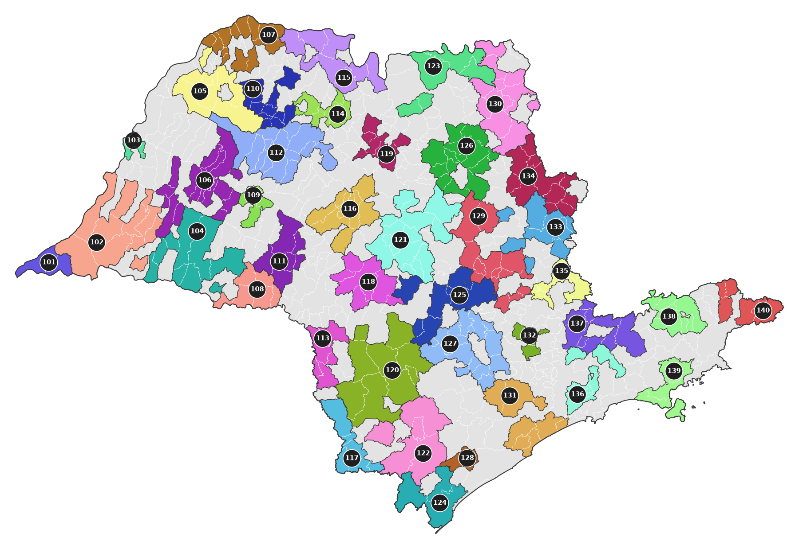
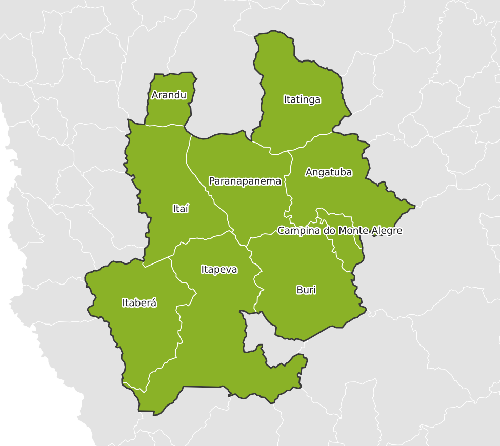

# rotamap

[](https://github.com/gabrielazeved1/rotamap/actions/workflows/ci.yml)


Transforma uma planilha de rotas de entrega em **mapas por município** e numa **apresentação
PowerPoint navegável**: capa, um mapa clicável com todas as rotas e um slide por rota com
mapa, KPIs e lista de cidades. Funciona para qualquer UF, com a malha oficial do IBGE.

<p align="center">
  
</p>

## Por que existe

O projeto nasceu de um freela para uma distribuidora: todo mês, alguém exportava um relatório
do ERP e montava à mão um PowerPoint com o mapa de cada rota. A primeira versão foram scripts
soltos que só funcionavam para aquele cliente, aquele relatório e o estado de São Paulo, e que
tinham problemas visíveis: números das rotas encavalados no mapa, cores repetidas lado a lado,
cidades com nome fora do padrão quebrando o mapa e botões clicáveis alinhados na tentativa e erro.

O `rotamap` é a reescrita genérica: entrada documentada, qualquer UF, etapas que rodam juntas
ou separadas, e cada um daqueles problemas resolvido e coberto por teste.

## Início rápido

Requer Python 3.11+.

```bash
git clone https://github.com/gabrielazeved1/rotamap.git
cd rotamap
pip install -e .

# dados sinteticos ja inclusos: 40 rotas em SP
rotamap run examples/rotas_exemplo.csv -c examples/config_exemplo.toml -o saida/
```

Abra `saida/apresentacao.pptx` e entre no modo de apresentação (F5): os números do mapa,
a grade de rotas e os botões de navegação são links entre os slides.

Para testar em outro estado, gere um exemplo sintético com municípios reais da UF:

```bash
rotamap exemplo --uf MG --rotas 30 -o teste/rotas.csv
rotamap run teste/rotas.csv -o teste/
```

## Formato de entrada

Um CSV com uma linha por município de cada rota:

| coluna         | obrigatória                | exemplo                                   |
| -------------- | -------------------------- | ----------------------------------------- |
| `rota_id`      | sim                        | `101`                                     |
| `rota_nome`    | sim                        | `Região de Campinas`                      |
| `municipio`    | sim                        | `Ribeirão Preto`                          |
| `uf`           | sim                        | `SP`                                      |
| `cod_ibge`     | não, mas evita ambiguidade | `3543402`                                 |
| `ordem`        | não                        | `3`                                       |
| qualquer outra | não                        | `valor_total`, `entregas`, `lucro_pct`... |

Toda coluna extra é tratada como métrica numérica. O leitor junta todos os problemas do arquivo
numa única mensagem, com o número da linha (UF inválida, rota com dois nomes, município repetido,
métrica que não é número), em vez de parar no primeiro.

O formato `erp_914` é um adaptador para o relatório "914 - Rentabilidade por Rota" do ERP
original: um layout de impressão salvo como CSV, em Mac Roman, com cabeçalho repetido a cada
página. Ele fica como exemplo de como encaixar uma exportação real e bagunçada no formato acima.

## Como funciona

```
CSV ──parse──▶ rotas.json ──geo──▶ rotas_geo.json ──maps──▶ mapas/ ──ppt──▶ apresentacao.pptx
                                   rotas_geo.gpkg            capa, menu, hotspots.json,
                                   matching.csv              um PNG por rota
```

Cada etapa lê o artefato da anterior, então dá para rodar por partes:

```bash
rotamap parse dados.csv -o saida/   # valida e normaliza
rotamap geo -o saida/               # associa os municípios à malha do IBGE
rotamap maps -o saida/              # desenha os mapas
rotamap ppt -o saida/               # monta a apresentação
```

### Associação com o IBGE

Nomes que vêm de ERP raramente batem com os oficiais. Para cada linha, o `rotamap` tenta,
nesta ordem:

1. **código IBGE**, se veio na entrada;
2. **alias** do arquivo de configuração (`"CD CAMPINAS" = "Campinas"`; texto vazio marca o
   que não é cidade, como "retirada no balcão");
3. **nome exato**, depois de normalizar acentos, apóstrofos (`d'Oeste`, `D´OESTE`, ``D`ALHO``),
   hífens e pontuação;
4. **distrito**: "Bonfim Paulista" vira Ribeirão Preto pela API de distritos do IBGE;
5. **aproximado**, por similaridade de texto acima de um limite configurável;
6. **prefixo**: "CAMPINAS NORTE" e "RIBEIRAO PRETO FILIAL" viram o município do começo do nome.

O resultado de cada linha vai para o `matching.csv`, com os casos que pedem revisão primeiro.
No relatório real do freela, todos os municípios foram associados sem correções no código; a
versão anterior precisava de um dicionário fixo com 16 exceções.

A malha e os nomes vêm da API de serviços de dados do IBGE e ficam em cache local
(`~/.cache/rotamap`). Também é possível apontar um shapefile do IBGE e trabalhar sem rede.

### Mapas

- **Cores por vizinhança**: cada rota recebe uma cor distinta, e a distribuição afasta ao máximo
  as cores de rotas vizinhas (um guloso seguido de trocas que nunca pioram o pior contraste).
- **Números sem sobreposição**: o ponto de partida é o centro do maior círculo que cabe na rota;
  se colidir, o rótulo vai para a posição livre mais próxima dentro da própria rota.
- **Alinhamento garantido**: o mapa é projetado (SIRGAS 2000 / Policônica), o eixo ocupa a figura
  inteira e as posições dos números são exportadas em coordenadas relativas. Um teste abre o PNG
  e confere o pixel embaixo de cada número.

<p align="center">
  
</p>

### Apresentação

No menu, os números são círculos nativos do PowerPoint sobre o mapa: ficam nítidos em qualquer
zoom e editáveis. Cada slide de rota mostra os KPIs configurados, com agregação correta
(soma, média, média ponderada, razão ou contagem de municípios) e formato brasileiro de moeda
e porcentagem.

## Configuração

Tudo é opcional e fica num arquivo TOML; veja o [`config.example.toml`](config.example.toml)
comentado. Um trecho:

```toml
titulo = "Rotas de entrega"

[geo.aliases]
"FILIAL RIBEIRAO" = "3543402"
"RETIRADA NO BALCAO" = ""

[[metricas]]
rotulo = "Margem"
coluna = "lucro_pct"
agregacao = "ponderada"
peso = "valor_total"
formato = "percentual"
casas = 1
```

Chaves desconhecidas geram erro com a lista das válidas, para erro de digitação não passar
em silêncio.

## Desenvolvimento

```bash
pip install -e ".[dev]"
pre-commit install

ruff check . && ruff format --check .
mypy            # modo strict
pytest          # sem acesso à rede
```

- Layout `src/`, empacotamento PEP 621, tipagem em tudo, dataclasses para os modelos
- Uma responsabilidade por módulo: `io` (entrada), `geo` (IBGE e matching), `render` (mapas),
  `ppt` (apresentação), `pipeline` e `cli`
- Mais de 130 testes e 97% de cobertura, incluindo um ponta a ponta; os testes nunca acessam a rede
- CI no GitHub Actions com Python 3.11 e 3.12

## Limitações

- O desenho do mapa geral considera as UFs presentes nos dados; mapas com muitas UFs funcionam,
  mas o layout foi pensado para uma ou poucas.
- O rótulo de cada rota fica dentro dela; em rotas muito finas e cercadas, ele pode encostar
  na borda.

## Licença

[MIT](LICENSE)
